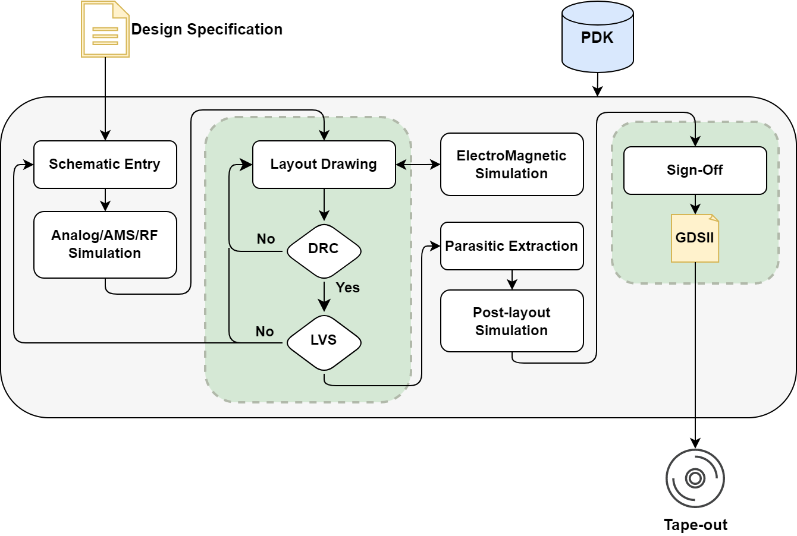

# Module 4 – StrongARM Latch Design

The **StrongARM latch** is a clocked dynamic comparator: it turns a small differential input voltage into a logic-level decision through positive feedback. This module follows the comparator from architecture and schematic capture to simulation, matched layout, physical verification, and post-layout analysis using the **IHP Open PDK**.

**This module can be delivered in 1 or 2 days depending on the level of the audience.** It can be taken independently after [Module 0 – Foundations](../module_0_foundations/README.md).

The actual implementation is [IHP__CMP7345](https://github.com/KrzysztofHerman/IHP__CMP7345), included in this directory as a Git submodule. Work through the numbered parts to understand what to build, how to simulate it, and how each schematic and layout decision affects the comparator's behavior.

## Learning Objectives

By the end of the module, you should be able to:

- Explain reset, early amplification, regeneration, and output retention.
- Capture and inspect a StrongARM schematic and its matched sub-blocks in Xschem.
- Measure decision delay, investigate mismatch and process variation, and observe metastability and kickback in ngspice.
- Build a symmetry-aware layout and use DRC and LVS to check it.
- Compare schematic and extracted simulations, then explain the role of fill, density checks, and a chip-level sealring.

## Module Structure

| Part | Topic | Main tools |
|------|-------|------------|
| [1](part_1_schematic/README.md) | Architecture, sizing, and schematic capture | Xschem |
| [2](part_2_simulations/README.md) | Transient, mismatch, process variation, and kickback | Xschem, ngspice |
| [3](part_3_layout/README.md) | Matched device groups, dummies, taps, and routing | KLayout |
| [4](part_4_physical_verification/README.md) | DRC, LVS, and connectivity debugging | KLayout, IHP verification decks |
| [5](part_5_pex/README.md) | PEX and schematic-versus-layout comparison | KLayout-PEX, Magic, ngspice |
| [6](part_6_chip_finishing/README.md) | Chip finishing, PVT, and design improvements | KLayout, ngspice |

## Design Flow and Targets



Begin with a readable schematic and a nominal transient bench. Use mismatch, process, and kickback experiments to identify which device groups need attention. Translate the circuit into matched layout sub-blocks, establish geometric and electrical correctness with DRC/LVS, and then repeat the measurements with extracted parasitics.

| Design concern | Goal of the exercise | Evidence to collect |
|----------------|----------------------|---------------------|
| Offset | Understand and reduce input-referred error in the low-millivolt range | Decision-threshold distribution and its mean/spread |
| Speed | Explore high-speed operation, including hundreds-of-megahertz-class timing requirements | Clock-to-output delay versus differential input and operating conditions |
| Power | Use a dynamic core with no intentional static current during reset | Supply-current waveform and switching energy |
| Output validity | Reach logic-compatible levels before the next stage samples | Both output polarities, reset behavior, and retention if an output latch is added |
| Robustness | Preserve useful decisions under mismatch, parasitics, and source loading | Statistical results, kickback plots, and pre-/post-layout comparison |

These are design objectives, not guaranteed performance specifications. The supplied nominal bench runs at approximately 100 MHz; establish its baseline before increasing frequency. A change that improves one metric can worsen another, so retain comparable measurements throughout the design flow.

## Delivery Options

Both formats cover the same design flow. Complete installation and submodule initialization before the first session.

### One Day – Experienced Audience

For participants already familiar with transistor-level analog design, Xschem/ngspice, and basic layout:

| Session | Activity |
|---------|----------|
| Morning, first session | Review architecture and sizing; inspect the supplied basic and final schematics (Part 1). |
| Morning, second session | Run nominal transient analysis and selected mismatch, process, and kickback experiments (Part 2). |
| Afternoon, first session | Review the supplied matched layout; run and interpret DRC/LVS (Parts 3–4). |
| Afternoon, second session | Compare schematic and PEX behavior; demonstrate extraction and finishing, then discuss trade-offs (Parts 5–6). |

Use the provided implementation to keep the session focused on interpretation and iteration. Longer statistical sweeps and independent layout reconstruction can continue as self-paced exercises.

### Two Days – Guided Audience

For participants with basic electronics knowledge who need more practice with the open-source tools or comparator design:

| Day | Morning | Afternoon |
|-----|---------|-----------|
| 1 | Tool check, optional RC-divider warm-up, latch operation, and guided schematic capture (Part 1). | Transient waveforms, automatic delay measurements, mismatch/process experiments, and kickback (Part 2). |
| 2 | Construct matched sub-blocks, assemble the layout, and debug DRC/LVS (Parts 3–4). | Extract parasitics, compare post-layout results, review chip finishing, and present observations (Parts 5–6). |

## Prerequisites and Tools

- Basic MOS device, differential-pair, and digital timing knowledge.
- The SG13G2 IHP Open PDK configured as described in [Module 0](../module_0_foundations/README.md).
- **Xschem** for schematic capture and testbenches; **ngspice** with the PDK's required model support.
- **KLayout** with the SG13G2 technology, PCells, DRC, and LVS decks.
- **Magic** and **KLayout-PEX (`kpex`)** for the extraction exercise; see the [KLayout-PEX repository and installation instructions](https://github.com/iic-jku/klayout-pex).

The design uses low-voltage MOS devices, local `ptap1`/`ntap1` ties, and `dantenna`/`dpantenna` structures where required. Keep the comparator routing within **Metal1–Metal3**. Restricting the core to this device and routing set also supports studying portability to **CMOS5L**; the commands and models in this module use **SG13G2**. Process-specific verification is required for each implementation.

## Get the Design and Set Up Paths

From the academy repository root:

```bash
git submodule update --init --recursive modules/module_4_strong_arm_latch/IHP__CMP7345
export ACADEMY_ROOT="$PWD"
export CMP7345_ROOT="$ACADEMY_ROOT/modules/module_4_strong_arm_latch/IHP__CMP7345/CMP7345-main"
```

The academy pins a specific design revision. `git submodule update --init --recursive` retrieves that revision for an existing checkout; a new academy clone can use `git clone --recurse-submodules`.

Use your installed PDK location for `PDK_ROOT` and export the technology name. For example, if the PDK is installed under `$HOME/IHP-Open-PDK`:

```bash
export PDK_ROOT="$HOME/IHP-Open-PDK"
export PDK=ihp-sg13g2
export PDKPATH="$PDK_ROOT/$PDK"
```

The design's local `xschemrc` files source `$PDK_ROOT/$PDK/libs.tech/xschem/xschemrc`. Start Xschem from the indicated schematic or testbench directory so that it loads this configuration. Confirm the primitive models and `sg13g2_stdcell.spice` resolve using the PDK setup before simulating.

### Design File Map

All paths below are relative to `IHP__CMP7345/CMP7345-main/`:

| Path | Purpose |
|------|---------|
| `schematic/xschem/CMP7345-basic.sch` | Readable transistor-level core |
| `schematic/xschem/CMP7345-final.sch` | Layout-oriented hierarchy with matched device groups |
| `schematic/xschem/CMP7345.sch` | Schematic selected by `CMP7345.sym`; initially a link to the basic view |
| `testbenches/tran/xschem/` | Nominal, mismatch, process, and PEX transient benches |
| `testbenches/noise/xschem/CMP7345_kickback.sch` | Input kickback experiment |
| `layout/klayout/CMP7345.gds` | Comparator layout and nearby sub-block layouts |
| `netlist/schematic/` | Exported schematic netlists |
| `netlist/layout/` | Layout-extracted connectivity netlists |
| `netlist/pex/` | Parasitic netlist and dedicated PEX symbol |

## Results to Keep

Keep a short design report with the selected schematic view, device sizes, PDK/design revisions, simulation conditions, nominal delay, statistical observations, kickback plots, DRC/LVS results, and a schematic-versus-PEX comparison. Treat performance targets as exercise goals and report the values actually measured.

## References

- [CMP7345 design repository](IHP__CMP7345/README.md) and [design calculations](IHP__CMP7345/doc/Design.md).
- B. Razavi, *The Design of a Comparator*, IEEE Solid-State Circuits Magazine, Fall 2020.
- B. Razavi, *The StrongARM Latch [A Circuit for All Seasons]*, IEEE Solid-State Circuits Magazine, vol. 7, no. 2, pp. 12–17, Spring 2015.
- M. J. M. Pelgrom, A. C. J. Duinmaijer, and A. P. G. Welbers, *Matching Properties of MOS Transistors*, IEEE Journal of Solid-State Circuits, vol. 24, no. 5, pp. 1433–1440, October 1989.
- B. Wicht, T. Nirschl, and D. Schmitt-Landsiedel, *Yield and Speed Optimization of a Latch-Type Voltage Sense Amplifier*, IEEE Journal of Solid-State Circuits, vol. 39, no. 7, pp. 1148–1158, July 2004.
- [IHP physical and design verification](https://ihp-open-pdk-docs.readthedocs.io/en/latest/verification.html) and [chip finishing](https://ihp-open-pdk-docs.readthedocs.io/en/latest/finishing/filler.html).
