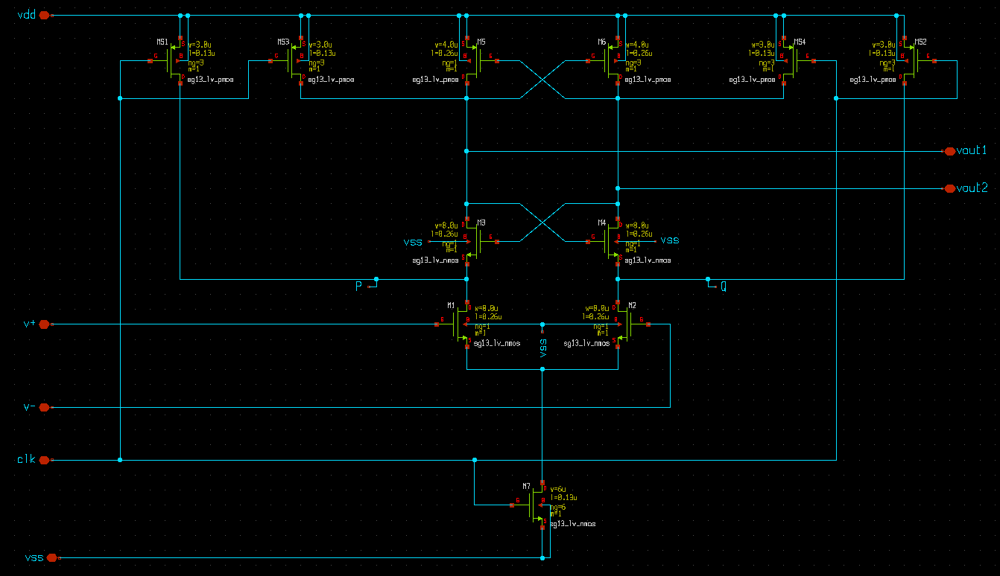
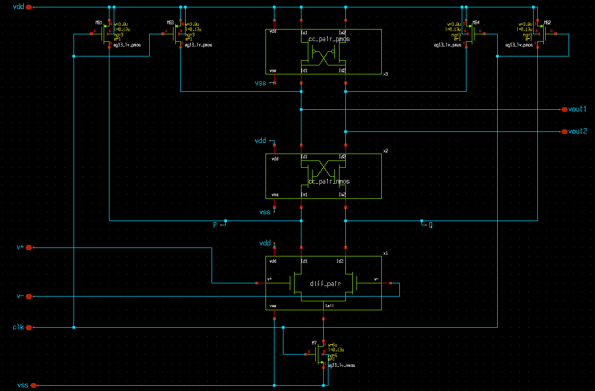

# Part 1 – Architecture and Schematic Capture

[Module overview](../README.md) · [Next: Simulations](../part_2_simulations/README.md)

The StrongARM latch combines a differential input pair with a clocked current path and cross-coupled regenerative devices. It is useful in data converters because the core draws no intentional static current during reset and rapidly amplifies a small input difference during evaluation.

## Read the Architecture



| Devices | Role |
|---------|------|
| `M1/M2` | Input differential pair: converts the input difference into unequal discharge currents; a major input-offset contributor. |
| `M3/M4` | NMOS cross-coupled pair: contributes to the discharge and regeneration paths. |
| `M5/M6` | PMOS cross-coupled pair: positive feedback drives the decision toward the supply rails. |
| `M7` | Clocked tail switch: enables evaluation and influences speed, energy, and kickback. |
| `MS1–MS4` | Reset switches: precharge internal nodes and outputs before the next comparison. |

### Reset and Evaluation

1. **Clock low – reset:** the tail switch is off and the PMOS reset switches precharge the internal nodes. The two branches should begin the next comparison in equivalent states.
2. **Clock high – evaluation:** the tail path turns on. A differential input produces unequal discharge rates; the cross-coupled devices then regenerate that imbalance into a full decision.
3. **Next reset:** the raw comparator outputs return to the precharge state. A following SR latch can retain the decision between comparisons. Output inverters alone provide buffering, not memory.

Incomplete reset creates a dependence on the previous decision. Unequal output loading can create a systematic preference even with nominally matched input devices.

## Open and Capture the Schematic

Use the environment variables from the [module setup](../README.md#get-the-design-and-set-up-paths):

```bash
cd "$CMP7345_ROOT/schematic/xschem"
xschem CMP7345-basic.sch
```

Identify `P`, `Q`, `clk`, `v+`, `v-`, `vout1`, and `vout2`. Trace the reset and evaluation current paths before editing sizes. For the guided exercise, draw the core yourself and use this file as the reference.

Useful Xschem shortcuts from the workshop are `q` (properties), `m` (move), `c` (copy), `Alt+R` (rotate), `Alt+F` (flip), `w` (wire), and `Shift+A` (inspect the netlist).

### Optional Tool Warm-Up

For the two-day format, first draw a resistive divider with `R1` from the source to `Vdiv` and `R2` from `Vdiv` to ground. Put `C1` across `R1` and `C2` across `R2`. Run an operating-point analysis and a transient simulation with a pulsed source. Check the DC divider ratio and explain how the capacitors change the step response. This introduces sources, labels, grounding, netlisting, and waveform inspection before the latch exercise.

## Starting Sizes and Trade-Offs

The basic CMP7345 design uses the following dimensions. Widths are the total width of each transistor, not an extra factor to multiply by `ng`.

| Devices | Width | Length | Implementation note |
|---------|-------|--------|---------------------|
| `M1/M2` | 8 µm each | 0.26 µm | Final view uses eight 1 µm unit devices per side. |
| `M3/M4` | 8 µm each | 0.26 µm | Final view uses eight 1 µm unit devices per side. |
| `M5/M6` | 4 µm each | 0.26 µm | Final view uses four 1 µm unit devices per side. |
| `M7` | 6 µm | 0.13 µm | Six gate fingers. |
| `MS1–MS4` | 3 µm each | 0.13 µm | Three gate fingers per switch. |

The workshop uses Pelgrom-style reasoning to motivate matching area:

$$\sigma(\Delta V_{TH}) \approx \frac{A_{VTH}}{\sqrt{WL}}$$

Larger input devices can reduce random threshold mismatch but add capacitance. A stronger tail switch can reduce delay while increasing switching disturbance. Stronger reset devices improve precharge but add clock loading. Change one group at a time and measure the effects in Part 2.

The workshop's low-millivolt offset and high-speed operation are design goals. Use simulation to establish what the chosen sizes achieve under the actual load and operating conditions.

## Move to the Layout-Compatible View

```bash
cd "$CMP7345_ROOT/schematic/xschem"
xschem CMP7345-final.sch
```



The final view introduces `diff_pair`, `cc_pair_nmos`, and `cc_pair_pmos` subcircuits, unit devices, dummies, local taps, and protection structures. Match each sub-block to the architectural transistor pair, keeping effective width and bulk connections explicit.

The testbenches instantiate `CMP7345.sym`, which opens `CMP7345.sch`. In the pinned design, `CMP7345.sch` is a symbolic link to `CMP7345-basic.sch`. Use the basic view for the initial simulation exercises. When validating the layout-compatible circuit, switch that link to `CMP7345-final.sch` in your exercise checkout and regenerate the netlist. Record the selected view with each result.

### Exercise Outcome

- Explain the role of each transistor group and the two clock phases.
- Produce a readable, symmetric schematic with named internal nodes and correct supply/bulk connections.
- Inspect the generated netlist and identify the selected schematic view, effective device widths, and symbol pin order.
- Explain why a separate output memory element may be needed.
