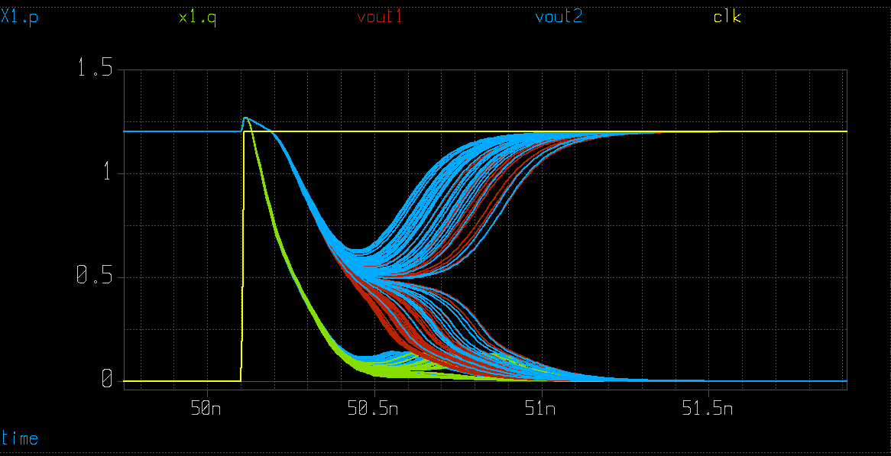
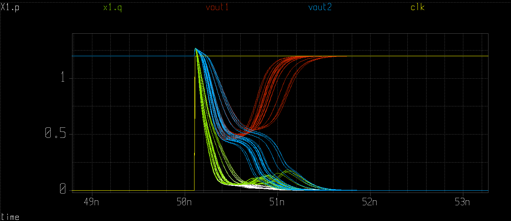
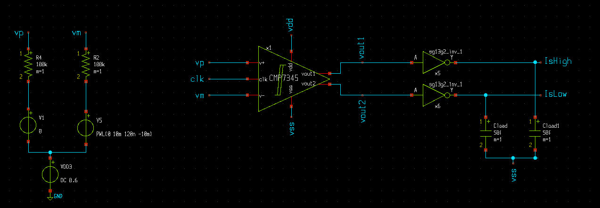

# Part 2 – Simulation and Characterization

[Previous: Schematic](../part_1_schematic/README.md) · [Module overview](../README.md) · [Next: Layout](../part_3_layout/README.md)

The decision event is nonlinear and clock-driven, so **transient analysis** is the main characterization tool. DC analysis helps inspect bias and headroom; AC analysis is useful for separately biased linear sub-blocks rather than for measuring the latch's regenerative decision.

## Choose the Analysis for the Question

| Analysis | Setup | What to inspect |
|----------|-------|-----------------|
| DC / operating point | Fixed clock and input conditions | Device headroom, source connections, and basic bias behavior |
| Transient | Clock pulses and a differential stimulus | Reset, early amplification, regeneration, decision polarity, and delay |
| AC | The RC divider or another biased linear sub-block | Attenuation, bandwidth, and pole/zero behavior |
| Mismatch Monte Carlo | Repeated transients with local mismatch enabled | Spread in decisions, offset, and delay |
| Process variation | Statistical process models or selected corners | Global changes in speed, reset strength, and output swing |
| Kickback transient | Finite input-source impedance | Charge and voltage disturbance returned to the source |

An operating point with the clock fixed does not reproduce the sequence that makes a dynamic decision. Establish correct transient behavior before interpreting statistical runs.

## Nominal Transient Testbench

With the [module environment](../README.md#get-the-design-and-set-up-paths) configured:

```bash
cd "$CMP7345_ROOT/testbenches/tran/xschem"
xschem CMP7345_tb.sch
```


The supplied bench uses a **1.2 V supply**, a **0.6 V input reference**, a clock period of approximately **10 ns**, and **50 fF loads** on the buffered outputs. Inspect the source connections: `vp` stays at the reference while the source driving `vm` ramps from +10 mV to −10 mV relative to it over 120 ns. Consequently, `vp - vm` changes from negative to positive.

### Build the Sources and Loads

To reconstruct the bench, place `CMP7345.sym`, connect its supplies, and add the following sources. These are the electrical connections expressed as SPICE statements; Xschem generates equivalent statements from the source symbols:

```spice
VDD vdd 0 DC 1.2
VSS vss 0 DC 0
VREF vref 0 DC 0.6
VP vp vref DC 0
VM vm vref PWL(0 10m 120n -10m)
VCLK clk 0 PULSE(0 1.2 0 10p 10p 5n 10.02n)
```

Connect `vp` and `vm` to the comparator's positive and negative inputs. Place one `sg13g2_inv_1` output inverter on each raw output, power both from `vdd`/`vss`, and attach 50 fF to each buffered output. Label the buffered nodes `IsHigh` and `IsLow`. The pulse has finite rise/fall times, a 5 ns high interval, and a period of 10.02 ns.

Keep the definitions of differential and common-mode voltage separate:

$$V_{diff}=V_{p}-V_{m},\qquad V_{CM}=\frac{V_p+V_m}{2}$$

The supplied single-sided ramp also changes common-mode voltage slightly. For a constant-common-mode experiment, drive $V_p=V_{CM}+V_{diff}/2$ and $V_m=V_{CM}-V_{diff}/2$ instead.

### Select the Models

The nominal model block is:

```spice
.lib cornerMOSlv.lib mos_tt
.lib cornerDIO.lib dio_tt
.lib cornerRES.lib res_typ
.INCLUDE sg13g2_stdcell.spice
```

`.lib` selects a named model section; `.INCLUDE` inserts a complete file, here the standard cells used for output buffering.

Place the model statements in a `code_shown` symbol named `MODEL`. Use a second `code_shown` symbol named `NGSPICE` for the following control block:

```spice
.options cshunt=20f
.options rseries=1
.control
save all
tran 10p 120n
meas tran tdly TRIG v(clk) VAL=0.6 RISE=11 TARG v(IsHigh) VAL=0.6 RISE=5
write tran.raw
.endc
```

Generate the netlist, run ngspice using Xschem's **Simulate** action, and use the **load waves** launcher to display `tran.raw`. Inspect `vp`, `vm`, `clk`, `x1.p`, `x1.q`, `vout1`, `vout2`, and the buffered `IsHigh`/`IsLow` outputs.

| Command | Purpose |
|---------|---------|
| `.control` / `.endc` | Delimit ngspice control-language commands. |
| `save all` | Save the default node-voltage and branch-current vectors; request additional device currents explicitly if needed. |
| `tran 10p 120n` | Run 120 ns of transient analysis with a 10 ps output-step parameter. The simulator chooses internal steps adaptively. |
| `meas tran tdly ...` | Calculate the time between selected clock and output crossings. |
| `write tran.raw` | Save the waveform database for inspection in Xschem. |

If time-step sensitivity is important, use `tran 10p 120n 0 10p` to impose a 10 ps maximum internal step and compare with a smaller limit. The first and fourth parameters serve different purposes.

The delay measurement is tied to the supplied stimulus and its crossing counts. Check that the trigger and target belong to the same evaluation event. Re-select the edge counts when changing the stimulus, clock, or output polarity. A missing or negative measurement is a reason to inspect the selected edges.

The supplied bench includes `cshunt` and `rseries` as numerical options. In particular, `cshunt=20f` adds capacitance at circuit nodes and can materially affect this small latch. In ngspice, `rseries` is an inductor series-resistance option, so its effect depends on inductors being present. Record these settings and check sensitivity before drawing performance conclusions.


### Read the Decision in Time Order

1. **Before the rising clock edge:** `P`, `Q`, and the raw outputs should have recovered toward the precharge level. Compare both branches, not only the final logic state.
2. **Immediately after the edge:** the tail path opens and `P`/`Q` begin to discharge. The difference between their trajectories is the early analog amplification.
3. **During regeneration:** the cross-coupled devices amplify the imbalance. One raw output falls while the other returns toward `vdd`.
4. **At the sampling instant:** check that the receiving stage sees an unambiguous state and that the decision has met the required timing margin.
5. **During the next reset:** check that the previous decision does not leave residual branch imbalance.

The stored measurement uses the 11th rising crossing of `clk` and the 5th rising crossing of `IsHigh`, both at 0.6 V. These counters are independent. Plot the two selected events and verify their association; the output may not transition on every clock cycle when the input polarity changes.

## Regeneration, Metastability, and Common Mode

During the positive-feedback-dominated interval, a useful local approximation is:

$$\Delta V(t)\approx\Delta V_0 e^{t/\tau_{reg}}$$

For a chosen decision level $\Delta V_{valid}$, this gives:

$$t_{reg}\approx\tau_{reg}\ln\left(\frac{\Delta V_{valid}}{|\Delta V_0|}\right)$$

This explains why reducing the input difference delays the decision. The approximation applies to the regeneration interval; the total clock-to-output delay also contains early amplification and output-buffer delay.

Run fixed-input experiments with both signs of 10 mV, 1 mV, 100 µV, and 10 µV. Keep common mode and loading fixed. Record unresolved cases separately from successful measurements. Sweep common mode next, within the permitted device voltages, and determine where the input pair or tail path loses useful headroom. A nominal result at 0.6 V does not establish the entire input common-mode range.

### Nominal Exercises

1. Identify precharge, early differential discharge, and strong regeneration in the waveforms.
2. Confirm decision polarity for both signs of `vp - vm` and full reset before the next evaluation.
3. Replace the ramp with fixed input differences, decreasing from millivolts toward microvolts. Plot delay against input difference and identify cases that fail to resolve within the evaluation window.
4. Change input-pair or tail width and compare delay, reset quality, and supply current with the baseline.

Keep balanced loads when studying metastability. Otherwise, load asymmetry can determine the decision before the small input signal does.

## Mismatch and Offset

```bash
cd "$CMP7345_ROOT/testbenches/tran/xschem"
xschem CMP7345_mismatch_tb.sch
```

Random mismatch arises from local differences in threshold voltage, current factor, effective dimensions, and device surroundings. Positive feedback amplifies these small imbalances, so near-zero inputs may produce different decisions from nominally identical comparators. Layout gradients and unequal loads can add systematic error on top of the random spread.

This bench selects `mos_tt_mismatch` and repeats transient runs using an ngspice `dowhile` loop and `reset`. The pinned design sets `mc_runs` to **50**. Begin with two runs when checking the control flow, then increase the count for distribution analysis.

1. Inspect the schematic selected by `CMP7345.sch`. Set `mm_ok=1` on the devices being studied, beginning with the input pair; selecting the mismatch library alone does not override an instance with mismatch disabled.
2. Confirm those instance parameters appear in the generated netlist. For the final view, inspect the individual unit devices within each matched sub-block.
3. Review the loop's output samples at 73 ns and its clock-to-output delay measurement. Check the waveforms to confirm that these times and crossings remain appropriate for your stimulus.
4. Compare the spread with input-pair mismatch alone and then with additional regenerative pairs enabled. Keep the configuration and sample count with the results.

The basic view currently enables mismatch on `M1/M2` and `M3/M4`. To isolate input-pair mismatch, explicitly disable it on `M3/M4` for that experiment. The final hierarchical view has separate unit-device settings, so check it independently when changing views.

### Model Block and Monte Carlo Control Loop

Use these model sections for local mismatch:

```spice
.lib cornerMOSlv.lib mos_tt_mismatch
.lib cornerRES.lib res_typ
.lib cornerDIO.lib dio_tt
.include sg13g2_stdcell.spice
```

The following expanded control block illustrates how to preserve measurements across transient plots. It belongs in a complete testbench with the sources, circuit, and models already present:

```spice
.options cshunt=20f
.options rseries=1
.control
save all
setplot const
let mc_runs = 50
let run = 0
setplot new
set scratch = $curplot
let vh = unitvec(mc_runs)
let vl = unitvec(mc_runs)
let vtdly = unitvec(mc_runs)
unset appendwrite

dowhile run < mc_runs
  reset
  tran 10p 120n
  meas tran vh1 FIND v(vout1) AT=73n
  meas tran vl1 FIND v(vout2) AT=73n
  meas tran tdly TRIG v(clk) VAL=0.6 RISE=2 TARG v(vout2) VAL=0.6 FALL=2
  set plt = $curplot
  setplot $scratch
  let vh[run] = {$plt}.vh1
  let vl[run] = {$plt}.vl1
  let vtdly[run] = {$plt}.tdly
  setplot $plt
  write tran.raw
  set appendwrite
  setplot const
  let run = run + 1
end

unset appendwrite
setplot $scratch
let sample = vector(mc_runs)
setscale sample
set wr_singlescale
set wr_vecnames
wrdata mismatch_results.txt vh vl vtdly
print vtdly
.endc
```

The loop works as follows:

- **Persistent bookkeeping:** the constant plot holds `run` and `mc_runs`; the scratch plot holds one result vector per measurement.
- **New realization:** `reset` reinitializes the circuit so the enabled statistical model parameters can be evaluated for another run.
- **Transient measurements:** `vh1` and `vl1` sample the two raw outputs, while `tdly` measures a selected decision delay. Their names do not guarantee which output is high when the decision flips.
- **Cross-plot access:** `$curplot` identifies the transient result; `{$plt}.vh1` accesses its scalar measurement while the scratch plot is selected.
- **Waveform storage:** the first `write` replaces the previous raw file, then `appendwrite` preserves subsequent runs in the same database.
- **Export:** `sample` becomes the horizontal scale and `wr_singlescale` writes it only once, followed by the output and delay columns. `wr_vecnames` adds a header.

Inspect the measurement log before analyzing these vectors. A failed crossing or unresolved decision must be classified explicitly; do not treat an unfilled vector entry as a valid sample. The illustrated crossing counts and 73 ns sampling time belong to the supplied ramp experiment and must be adjusted for other stimuli.



Read the overlay for both timing spread and changes in the winning branch. Similar final rails can conceal substantial variation in when a decision becomes valid.

### Extract Input-Referred Offset

The stored bench measures output levels and delay; these are useful observations but are not an extracted offset distribution. To estimate **input-referred offset**, vary the differential input for each fixed mismatch realization until the output decision changes. Keep the same random realization during that search, then draw a new realization for the next sample. Report the search resolution, mean offset, and standard deviation.

One practical search procedure is:

1. Choose a constant common-mode voltage and a fixed evaluation time after the clock edge.
2. Find a negative and positive differential input that produce opposite decisions for the current device realization.
3. Bisect this interval and repeat the decision, retaining the same mismatch realization throughout the search.
4. Stop when the interval is narrower than the chosen input-voltage resolution; its midpoint estimates the decision threshold.
5. Repeat for independent realizations and form a histogram. Report the mean, standard deviation, and the number of unresolved or out-of-range cases.

If changing the testbench uses `reset` and re-samples the model parameters, preserve the realization through a supported fixed seed or frozen parameter set before doing the search. The sign of reported offset depends on the chosen convention; state that convention with the results. An ascending/descending input sweep also helps reveal decision-history effects caused by incomplete reset.

Larger sample counts improve estimates of spread. Input-referred noise requires a suitable noisy-transient experiment; deterministic mismatch runs do not measure it.

## Process Variation

```bash
cd "$CMP7345_ROOT/testbenches/tran/xschem"
xschem CMP7345_process_tb.sch
```

The process bench uses **`mos_tt_stat`**, **`res_stat`**, and **20 runs** in the pinned design. It stores delay/output samples and writes `distribution.csv` for post-processing. ngspice's `wrdata` output is normally whitespace-delimited even when the filename ends in `.csv`.

Process variation can shift threshold voltage, mobility, effective width/length, resistance, and capacitance. Corners describe selected combinations of these shifts; statistical process models sample a distribution. The MOS and resistor sections for this experiment are:

```spice
.lib cornerMOSlv.lib mos_tt_stat
.lib cornerDIO.lib dio_tt
.lib cornerRES.lib res_stat
.include sg13g2_stdcell.spice
```

Reuse the control-loop structure above with `mc_runs = 20`, and replace its export command with:

```spice
wrdata process_results.txt vh vl vtdly
```

Keep `mm_ok` settings and the selected model sections with the results so local mismatch and global process variation can be distinguished. The diode model here remains nominal. Use the statistical sections and enable parameters supported by your installed PDK rather than assuming every component is randomized.



Local mismatch describes differences between nearby devices; process variation describes global shifts in device behavior. Compare decision correctness, output swing, reset completeness, and delay. Use identical stimulus, loading, and measurement definitions when comparing benches; the supplied ramp amplitudes differ and should be aligned for a controlled comparison.

As an extension, sweep supply and temperature along with supported process corners. Record which conditions leave the smallest evaluation-time margin.

## Kickback

```bash
cd "$CMP7345_ROOT/testbenches/noise/xschem"
xschem CMP7345_kickback.sch
```



The main disturbance paths are the input pair's gate-drain capacitances, clock feedthrough, charge sharing, and interconnect coupling. The reset-to-evaluation transition is especially important: the internal voltages begin moving rapidly just as the latch starts deciding a small input difference.


Clock transitions and regeneration inject charge back toward the input network. The kickback bench includes input resistances so this disturbance is visible as a voltage change. Inspect both input currents and voltages, separating the common-mode component `(vp + vm)/2` from the differential component `vp - vm`.

Repeat the experiment with different source impedances or tail sizes. Explain how a faster decision can also disturb the source more strongly. Ideal voltage sources directly at the input can mask this voltage disturbance, so preserve a meaningful source network.

For a constant input, record the pre-edge input level and compare it with the peak excursion and the value remaining at the next evaluation. The injected charge is related to the input current by $\Delta Q=\int i_{in}(t)\,dt$; on an approximately isolated sampling capacitor, $\Delta V\approx\Delta Q/C_{sample}$. This connects a visually small current pulse to the voltage error seen by a preceding sample-and-hold or DAC.

## Input-Referred Noise

Random decision noise is a separate experiment from mismatch. With a simulator configuration that supports the required transient-noise sources, repeat decisions for a fixed device realization and several small differential inputs. Plot the probability of one output state versus input difference. The center indicates an offset-like bias; the transition width reflects random input-equivalent uncertainty under those conditions.

Repeated deterministic transients produce neither thermal-noise samples nor a noise estimate. Keep noise, static mismatch, dynamic offset, and kickback distinct when interpreting the results.

## Common Simulation Problems

| Observation | First checks |
|-------------|--------------|
| Every Monte Carlo waveform is identical | Model section, instance `mm_ok` settings, and parameter re-evaluation on reset |
| Delay is negative or missing | Trigger/target edge association, output polarity, simulation duration, and unresolved cases |
| Decision depends strongly on the previous input | Reset duration, reset-device strength, and residual `P-Q` imbalance |
| One branch always wins | Differential stimulus, load symmetry, accidental connectivity differences, and selected mismatch sample |
| Sizing improves delay but worsens input behavior | Kickback, source impedance, and input-pair capacitances |
| Results change with numerical settings | Maximum time step, tolerances, and artificial shunt loading |

### Exercise Outcome

Keep annotated transient plots, a checked delay measurement, a comparison of mismatch/process runs, and an input-kickback plot. Include the schematic view, model sections, source/load conditions, sample count, and numerical options so another participant can reproduce the experiment.
