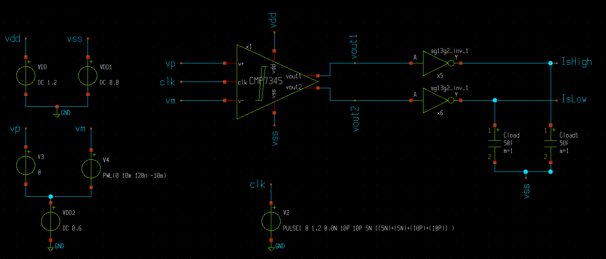
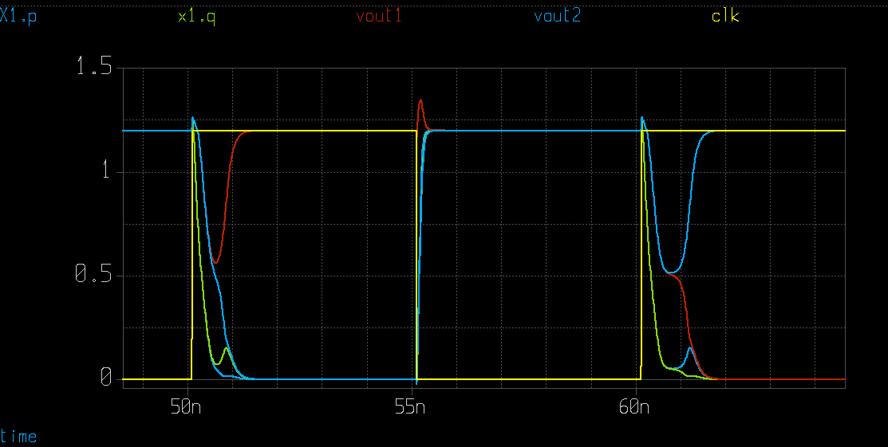
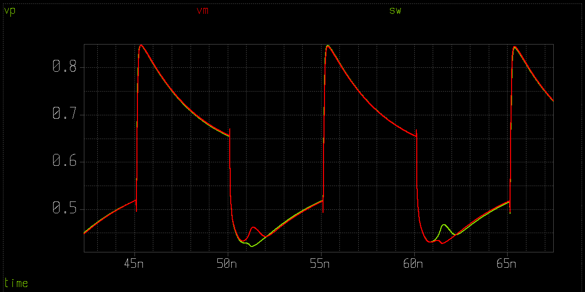

# Part 2 – Simulation and Characterization

[Previous: Schematic](../part_1_schematic/README.md) · [Module overview](../README.md) · [Next: Layout](../part_3_layout/README.md)

The decision event is nonlinear and clock-driven, so **transient analysis** is the main characterization tool. DC analysis helps inspect bias and headroom; AC analysis is useful for separately biased linear sub-blocks rather than for measuring the latch's regenerative decision.

## Nominal Transient Testbench

With the [module environment](../README.md#get-the-design-and-set-up-paths) configured:

```bash
cd "$CMP7345_ROOT/testbenches/tran/xschem"
xschem CMP7345_tb.sch
```



The supplied bench uses a **1.2 V supply**, a **0.6 V input reference**, a clock period of approximately **10 ns**, and **50 fF loads** on the buffered outputs. Inspect the source connections: `vp` stays at the reference while the source driving `vm` ramps from +10 mV to −10 mV relative to it over 120 ns. Consequently, `vp - vm` changes from negative to positive.

The nominal model block is:

```spice
.lib cornerMOSlv.lib mos_tt
.lib cornerDIO.lib dio_tt
.lib cornerRES.lib res_typ
.INCLUDE sg13g2_stdcell.spice
```

`.lib` selects a named model section; `.INCLUDE` inserts a complete file, here the standard cells used for output buffering.

A minimal control block adapted from the workshop is:

```spice
.options cshunt=20f
.options rseries=1
.control
save all
tran 10p 120n
meas tran tdly TRIG v(clk) VAL=0.6 RISE=11 TARG v(IsHigh) VAL=0.6 RISE=5
write tran.raw
.endc
```

Generate the netlist, run ngspice using Xschem's **Simulate** action, and use the **load waves** launcher to display `tran.raw`. Inspect `vp`, `vm`, `clk`, `x1.p`, `x1.q`, `vout1`, `vout2`, and the buffered `IsHigh`/`IsLow` outputs.

The delay measurement is tied to the supplied stimulus and its crossing counts. Check that the trigger and target belong to the same evaluation event. Re-select the edge counts when changing the stimulus, clock, or output polarity. A missing or negative measurement is a reason to inspect the selected edges.

The workshop includes `cshunt` and `rseries` as numerical options. In particular, `cshunt=20f` adds capacitance at circuit nodes and can materially affect this small latch. Record these settings and check sensitivity before drawing performance conclusions.



### Nominal Exercises

1. Identify precharge, early differential discharge, and strong regeneration in the waveforms.
2. Confirm decision polarity for both signs of `vp - vm` and full reset before the next evaluation.
3. Replace the ramp with fixed input differences, decreasing from millivolts toward microvolts. Plot delay against input difference and identify cases that fail to resolve within the evaluation window.
4. Change input-pair or tail width and compare delay, reset quality, and supply current with the baseline.

Keep balanced loads when studying metastability. Otherwise, load asymmetry can determine the decision before the small input signal does.

## Mismatch and Offset

```bash
cd "$CMP7345_ROOT/testbenches/tran/xschem"
xschem CMP7345_mismatch_tb.sch
```

This bench selects `mos_tt_mismatch` and repeats transient runs using an ngspice `dowhile` loop and `reset`. The pinned design sets `mc_runs` to **50**; the earlier workshop listing used **2** to demonstrate the mechanism.

1. Inspect the schematic selected by `CMP7345.sch`. Set `mm_ok=1` on the devices being studied, beginning with the input pair; selecting the mismatch library alone does not override an instance with mismatch disabled.
2. Confirm those instance parameters appear in the generated netlist. For the final view, inspect the individual unit devices within each matched sub-block.
3. Review the loop's output samples at 73 ns and its clock-to-output delay measurement. Check the waveforms to confirm that these times and crossings remain appropriate for your stimulus.
4. Compare the spread with input-pair mismatch alone and then with additional regenerative pairs enabled. Keep the configuration and sample count with the results.

The stored bench measures output levels and delay; these are useful observations but are not an extracted offset distribution. To estimate **input-referred offset**, vary the differential input for each fixed mismatch realization until the output decision changes. Keep the same random realization during that search, then draw a new realization for the next sample. Report the search resolution, mean offset, and standard deviation.

Larger sample counts improve estimates of spread. Input-referred noise requires a suitable noisy-transient experiment; deterministic mismatch runs do not measure it.

## Process Variation

```bash
cd "$CMP7345_ROOT/testbenches/tran/xschem"
xschem CMP7345_process_tb.sch
```

The process bench uses **`mos_tt_stat`**, **`res_stat`**, and **20 runs** in the pinned design. It stores delay/output samples and writes `distribution.csv` for post-processing. ngspice's `wrdata` output is normally whitespace-delimited even when the filename ends in `.csv`.

Local mismatch describes differences between nearby devices; process variation describes global shifts in device behavior. Compare decision correctness, output swing, reset completeness, and delay. Use identical stimulus, loading, and measurement definitions when comparing benches; the supplied ramp amplitudes differ and should be aligned for a controlled comparison.

As an extension, sweep supply and temperature along with supported process corners. Record which conditions leave the smallest evaluation-time margin.

## Kickback

```bash
cd "$CMP7345_ROOT/testbenches/noise/xschem"
xschem CMP7345_kickback.sch
```



Clock transitions and regeneration inject charge back toward the input network. The kickback bench includes input resistances so this disturbance is visible as a voltage change. Inspect both input currents and voltages, separating the common-mode component `(vp + vm)/2` from the differential component `vp - vm`.

Repeat the experiment with different source impedances or tail sizes. Explain how a faster decision can also disturb the source more strongly. Ideal voltage sources directly at the input can mask this voltage disturbance, so preserve a meaningful source network.

### Exercise Outcome

Keep annotated transient plots, a checked delay measurement, a comparison of mismatch/process runs, and an input-kickback plot. Include the schematic view, model sections, source/load conditions, sample count, and numerical options so another participant can reproduce the experiment.
