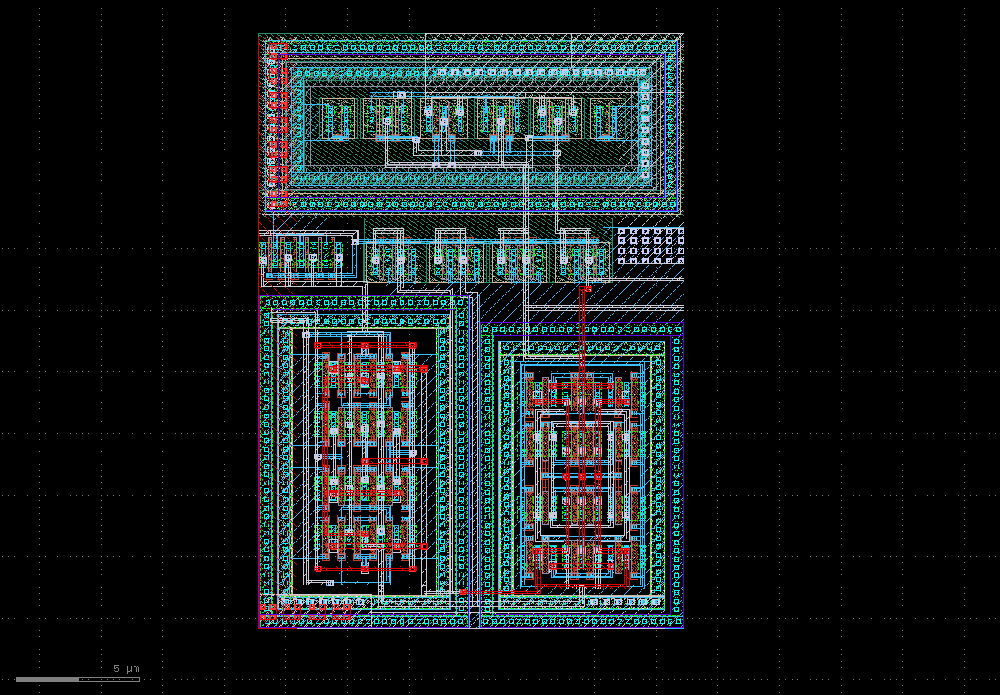
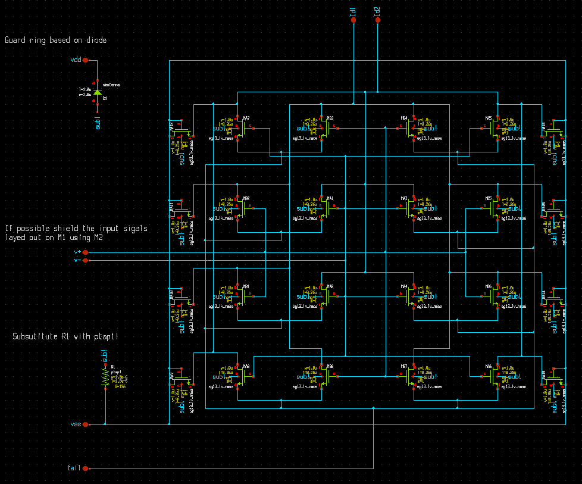
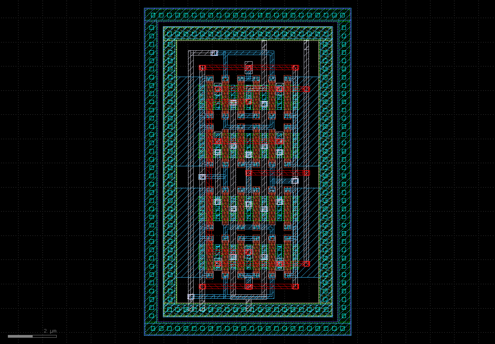
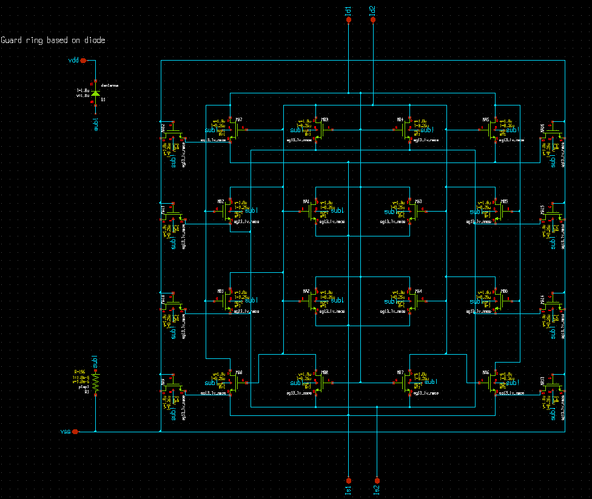
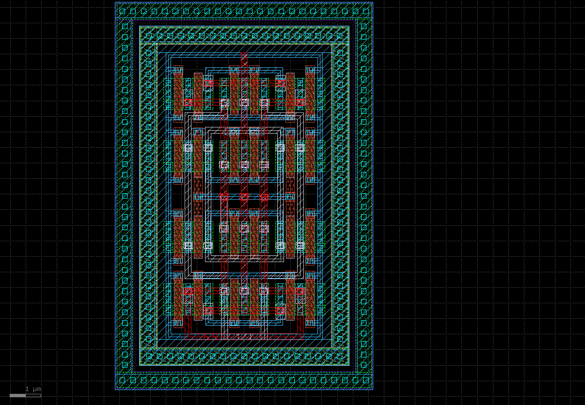
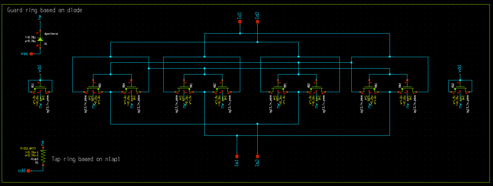
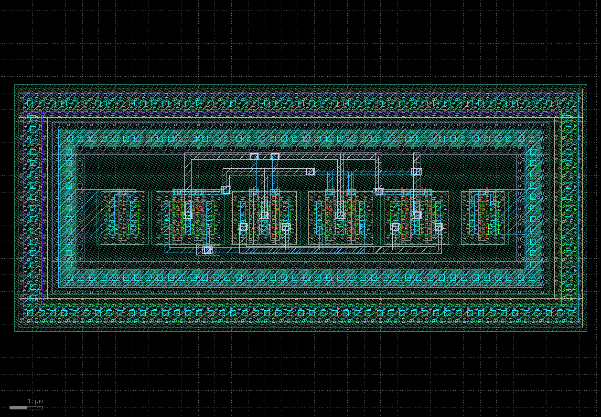

# Part 3 – Matched Layout

[Previous: Simulations](../part_2_simulations/README.md) · [Module overview](../README.md) · [Next: Physical Verification](../part_4_physical_verification/README.md)

The comparator's layout is part of its offset and timing design. Build the layout around matched device groups, balanced regenerative nodes, and a compact clock route.

## Open the Reference Layout

With KLayout's SG13G2 technology and PCells installed and the [module environment](../README.md#get-the-design-and-set-up-paths) configured:

```bash
klayout -e "$CMP7345_ROOT/layout/klayout/CMP7345.gds"
```



For the one-day format, inspect and verify this implementation. For the two-day format, reconstruct the matched sub-blocks in your exercise layout and compare them with the supplied GDS views.

KLayout provides parameterized cells, hierarchy, alignment and transformation operations, Python/Ruby scripting, and integrated verification. Use the SG13G2 PCells so device geometry is generated from process-aware parameters rather than drawing each transistor layer by hand.

| Key | Action |
|-----|--------|
| `q` | Edit the selected object's properties. |
| `m`, `c` | Move or copy. |
| `a` | Align selected objects. |
| `o` | Generate a via while using the path tool. |

Create an exercise layout with the SG13G2 technology and the intended top cell. Set device width, length, and finger count in the PCell properties. Keep the hierarchy aligned with `diff_pair`, `cc_pair_nmos`, and `cc_pair_pmos` so each block can be understood and verified independently.

## Build the Matched Sub-Blocks

| Block | Reference GDS under `layout/klayout/` | Main objective |
|-------|--------------------------------------|----------------|
| Input differential pair | `diff_pair/diff_pair.gds` | Matching, common-centroid placement, and a uniform local environment |
| NMOS cross-coupled pair | `cc_nmos_pair/cc_pair_nmos.gds` | Balanced discharge paths and node capacitances |
| PMOS cross-coupled pair | `cc_pmos_pair/cc_pair_pmos.gds` | Symmetric regeneration and supply connections |

## Differential Input Pair





Each input transistor is represented by eight active unit devices of $W=1\,\mu m$, $L=0.26\,\mu m$. Their parallel combination gives 8 µm of effective width per side. Identify these active fingers separately from the surrounding dummies.

1. Assign the active units to the `v+` and `v-` groups.
2. Distribute the groups around a common centroid, with the same orientation and local spacing.
3. Surround the active devices with the intended dummies to make edge environments more uniform. Use the dummy terminal connections in the final schematic.
4. Route the two gate networks with similar lengths, layer usage, and via counts.
5. Collect the drain networks into `P` and `Q` without introducing unnecessary asymmetry.
6. Connect the shared source network to the tail and implement the local substrate connection.

A common centroid means the average physical position of the active A devices equals that of the active B devices. For equal-sized units, verify:

$$\frac{1}{N}\sum_i(x_{A,i},y_{A,i})=
\frac{1}{N}\sum_i(x_{B,i},y_{B,i})$$

This helps reject approximately linear spatial gradients. It does not eliminate random mismatch or unequal routing capacitance. Check both the geometry and the electrical paths.

## NMOS Cross-Coupled Pair





The active devices again use eight 1 µm units per side at 0.26 µm length. Their sources connect to `P` and `Q`, while their gates and drains implement the cross-coupled output feedback.

- Follow each connection from the schematic port through the unit devices before routing the crossing.
- Balance the paths from the two outputs to the opposite gates.
- Keep corresponding drain/source routes comparable in width, length, and via count.
- Include the dummy and local tie structures represented in the schematic hierarchy.

A symmetrical-looking crossing can still connect the wrong branch. Label ports consistently and use net highlighting to trace `P`, `Q`, `vout1`, and `vout2` after assembly.

## PMOS Cross-Coupled Pair





Each active side uses four 1 µm units at 0.26 µm length. Place the two groups with a uniform well environment, include the intended dummies, and provide the local well connection through `ntap1`.

The source-side connections of both active branches must reach the intended supply. Check continuity through hierarchy boundaries, especially when a source port has an internal name rather than `vdd`. Keep the two output drain routes balanced because they are directly involved in regeneration.

## Local Taps and Protection Structures

The final schematic explicitly represents substrate/well ties and protection devices:

| Element | Purpose in the implementation |
|---------|-------------------------------|
| `ptap1` | Local substrate connection associated with NMOS regions |
| `ntap1` | Local well connection associated with PMOS regions |
| `dantenna`, `dpantenna` | Process-defined diode/protection structures represented in the circuit |
| Dummy MOS devices | Uniform surroundings for active matched devices, with defined terminal connections |

Preserve the intended electrical connections when transferring these structures into layout. Local body networks affect both device recognition and LVS, so a drawing with visually complete rings still needs an electrical check.

## Assemble and Route the Comparator

Place the three matched blocks in the top-level comparator, then add the tail switch and four reset switches. Check the final schematic beside the layout while routing:

1. Connect the input-pair drain networks to the NMOS pair's source-side ports.
2. Join the NMOS and PMOS drain networks into the two regenerative outputs.
3. Complete the cross-coupling without swapping the intended output names.
4. Connect the tail and all reset gates to a compact clock network.
5. Route supplies and local body connections, then expose the seven top-level ports.

Use **Metal1–Metal3** for the core routing. Match branch loading as well as wire appearance: a short wire on one branch and a long wire with extra vias on the other can create deterministic offset and unequal delay. Keep noisy clock routing away from sensitive inputs where practical. If shielding is used, apply it symmetrically and include the added load in extraction.

## Review Before Verification

| Item | What to compare |
|------|-----------------|
| Active device area | Unit count, width, length, fingers, and multiplicity against the final schematic |
| Matched surroundings | Orientation, dummies, wells, taps, and distance to nearby structures |
| Regenerative paths | Corresponding interconnect lengths, layers, vias, and output loads |
| Reset and clock | Compact gate distribution and complete precharge connectivity |
| Hierarchy and labels | Port names and connections at each sub-block boundary |

Run DRC as you construct each block, then verify the assembled comparator with the DRC/LVS procedure in [Part 4](../part_4_physical_verification/README.md).

### Exercise Outcome

Produce the three matched sub-blocks and an assembled comparator layout. Be able to identify active and dummy devices, explain the centroid arrangement and local body connections, and trace the differential and clock paths before running full physical verification.
